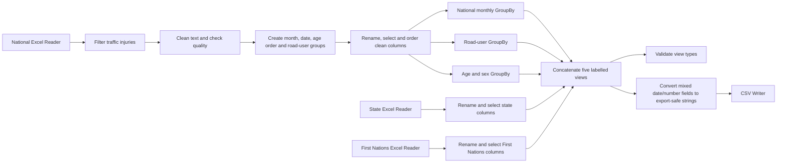

# Hospitalised injury project: source and KNIME workflow explanation

This document explains the hospitalised-injury work only. The separate 2025 police-enforcement brief is **not part of the current website or workflow**.

## The short explanation to give the lecturer

> We downloaded three official Excel workbooks from the Australian Government's Bureau of Infrastructure and Transport Research Economics (BITRE) Hospitalised Injury release of 22 September 2023. BITRE says the series was produced by the Road Safety Data Hub using Australian Institute of Health and Welfare hospital data. We did not invent or manually generate the observations. In KNIME we read the raw sheets, restricted the national file to traffic injuries, cleaned labels, checked duplicates and missing values, built dates and sort orders, produced five analysis views, and exported one chart-ready CSV for the D3 website. We kept the original workbooks and the BITRE data dictionary inside the exported KNIME package so the processing is reproducible.

## 1. Where the three Excel files came from

All three files are listed together on the official [BITRE Hospitalised Injury page](https://www.bitre.gov.au/resource/road-safety/hospitalised-injury). The release covers calendar years 2011–2021 and was published on 22 September 2023.

| Official file | Why it was needed | Sheet/range read in KNIME |
|---|---|---|
| `hospitalisation_injury_publication_sep2023.xlsx` | Detailed national raw data used for the trend, road-user, age and sex views | Sheet `raw`; whole sheet; row 1 contains column names |
| `state-and-territory-hospitalisation-injury-publication-2023.xlsx` | State and territory six-monthly totals | Sheet `raw`; range `A2:F178`; row 2 contains column names |
| `First-Nations-hospitalised-injuries-2023.xlsx` | First Nations status and age-group comparisons | Sheet `raw`; range `A2:G266`; row 2 contains column names |

The project also keeps BITRE's [Hospitalised Injury Data Dictionary](https://www.bitre.gov.au/sites/default/files/documents/hospitalised-injury-data-dictionary-september-2023.pdf). It explains that the underlying national hospital-separation records were sourced from the Australian Institute of Health and Welfare National Hospital Morbidity Database and documents the scope and inclusion rules.

### Evidence that can be shown to the lecturer

1. Open the official BITRE page above and show the same three filenames.
2. Open the exported `Group28.knwf` package and show `Group28/data/input/`; the three original workbooks and the data dictionary are embedded there.
3. Open each KNIME Excel Reader configuration to show its filename, `raw` sheet and read range.
4. Open the final CSV Writer configuration to show the workflow-relative output path.

The files contain presentation sheets such as Cover, Index and T1–T5 as well as a `raw` sheet. KNIME reads the `raw` sheet because it has the detailed records needed for reproducible filtering and aggregation. The formatted table sheets are useful for checking published totals but are not replacements for the raw input.

## 2. What the workflow produces

The workflow turns the three official workbooks into one file:

`data/output/traffic_injury_analysis_views.csv`

That CSV has five labelled views so the D3 website can load one data file:

| `view_type` | Rows | Used for |
|---|---:|---|
| `National Monthly` | 132 | National time trend |
| `National Road User` | 132 | Road-user ranking |
| `National Age and Sex` | 165 | Age and sex comparison |
| `State Six-Monthly` | 176 | State-by-year heatmap |
| `First Nations Age Group` | 264 | First Nations age profile |
| **Total** | **869** | Five interactive website sections |

The two extra KNIME charts created near the end—state totals and First Nations status by age—are validation/presentation branches. They help check the analysis visually. They do not add new records to the CSV because the detailed state and First Nations records were already included before those charts were added.

## 3. Workflow map

## 4. Detailed node explanation

### A. Read and inspect the national data

| Node(s) | What it does | Why it is there |
|---|---|---|
| **Excel Reader** | Reads `hospitalisation_injury_publication_sep2023.xlsx`, sheet `raw` | Starts from the official detailed data rather than copying values from a chart or summary table |
| **Statistics** | Summarises column types, ranges and missingness | First quality check before changing the data |
| **Value Counter** | Inspects category frequencies | Detects unexpected labels and rare values |
| **Row Filter** | Keeps `Cause of injury = Traffic` | The website is about road-traffic hospitalisations, not every injury cause in the workbook |
| **String Cleaner** | Trims leading/trailing and special whitespace in Month, remoteness, Age group, Sex, Road user and Counterparty | Prevents visually identical labels from becoming separate categories |
| **Value Counter – Month / Remoteness / Age Group / Sex / Road User / CounterParty** | Lists values and counts for each important categorical field | Confirms that cleaning produced the expected categories |
| **Duplicate Row Filter** | Uses year, month, remoteness, cause, age, sex, road user and counterparty as the duplicate key; retains the first occurrence | Prevents exact duplicate category records from being counted twice |
| **Missing Value** | Creates a controlled inspection branch for case-count fields | Makes missingness visible without silently replacing unpublished values with zero |
| **Histogram – Hospitalisation / Bed Days** | Shows the distributions of the two measures | Checks scale, skew and suspicious values |
| **Numeric Outliers – Inspection** | Flags unusual numeric values on a separate branch | Supports review; it does not delete high values from the main export path |

### B. Validate the published hospitalisation calculation

| Node | Configuration and purpose |
|---|---|
| **Math Formula – hospitalisations_check** | Calculates `Count of cases - Died_cases` |
| **Math Formula – difference** | Calculates `Hospitalisations - hospitalisations_check` |
| **Row Filter – Formula Errors** | Shows records where the difference is not zero |

This branch checks that the published hospitalisation field matches the definition used by the source. It is a validation branch and does not replace the published values in the main data path.

### C. Create fields needed for sorting and interaction

| Node | What it creates | Why |
|---|---|---|
| **Rule Engine – Month Number** | January = 1 through December = 12 | Correct chronological sorting |
| **Rule Engine – Month Code** | January = `01` through December = `12` | Builds a valid date string |
| **String Manipulation – date_text** | Joins year, month code and day `01` | Creates one date for each monthly observation |
| **String to Date&Time – date_text_date** | Parses `yyyy-MM-dd` as a local date | Gives the website a reliable time field |
| **Rule Engine – age order** | Assigns numeric order to the published age bands | Prevents alphabetical age sorting |
| **Rule Engine – road_user_group** | Combines related detailed road-user positions into readable groups such as Car occupant and Heavy vehicle occupant | Supports consistent higher-level exploration |
| **Value Counter – Validate Road User Group** | Checks the derived groups and exposes unmatched categories | Prevents an unnoticed category from being labelled incorrectly |

### D. Create the clean national table

| Node | What it does |
|---|---|
| **Column Renamer – Rename Columns** | Changes source names to consistent website-friendly names such as `year`, `age_group`, `hospitalisations`, `bed_days` and `period_date` |
| **Column Filter – filtering column** | Keeps only the 13 fields required by the analysis |
| **Column Resorter – Clean Data** | Places the columns in a stable, readable schema |

### E. Build the three national analysis branches

| Branch | Nodes and purpose |
|---|---|
| **National monthly** | **GroupBy – National Monthly** groups by year, month, month number and date and sums hospitalisations and bed days. **Sorter – Monthly Date** orders the timeline. **Line Plot** checks the trend. **Constant Value Column – Label National Monthly** sets `view_type = National Monthly`. |
| **Road user** | **GroupBy – Road User** groups by year and road user and sums both measures. **Sorter – Road User and Year** makes the table deterministic. **Bar Chart** checks the comparison. **Constant Value Column – National Road User** labels the view. |
| **Age and sex** | **GroupBy – Age/Sex** groups by year, age group, age order and sex and sums both measures. **Sorter – Age Sex Order** fixes category order. The long table is labelled by **Constant Value Column – National Age and Sex** for the website. A separate **Pivot**, **Missing Value**, **Sorter**, **Column Renamer** and **Bar Chart** branch creates the KNIME grouped-bar preview. |

### F. Build the state branch

| Node | What it does and why |
|---|---|
| **Excel Reader – State Excel Reader** | Reads the official state workbook, `raw!A2:F178` |
| **Column Renamer – Rename State Columns** | Standardises year, half-year, hospitalisations, bed days and state names |
| **Column Filter – Clean State Columns** | Removes fields not required by the website |
| **Constant Value Column – Label State View** | Adds `view_type = State Six-Monthly` before the final concatenate |
| **GroupBy – State Totals** | Sums hospitalisations and bed days by state for an overall check |
| **Sorter – State Hospitalisation Order** | Orders states from largest to smallest total |
| **Bar Chart – State Bar Chart** | Visually validates the state totals; it is not a second CSV export |

### G. Build the First Nations branch

| Node | What it does and why |
|---|---|
| **Excel Reader – First Nations Excel Reader** | Reads the official First Nations workbook, `raw!A2:G266` |
| **Column Renamer – Rename First Nations Columns** | Standardises year, half-year, status, age group, hospitalisations and bed days |
| **Column Filter – Clean First Nations Data** | Keeps only the fields required by the analysis |
| **Constant Value Column – Label First Nations View** | Adds `view_type = First Nations Age Group` before the final concatenate |
| **Rule Engine – First Nations Age Order** | Orders 0–7, 8–16, 17–25, 26–39, 40–64 and 65+ correctly |
| **String to Number** | Converts published numeric text to numbers using `.` as the decimal separator and `,` as the thousands separator. Values published as `n.p.` cannot be converted and remain missing rather than becoming zero. |
| **Pivot – First Nations Status Pivot** | Creates one series per First Nations status and sums hospitalisations by age group |
| **Sorter – First Nations Age Group Order** | Restores the intended age order |
| **Column Renamer – Rename First Nations Series** | Gives the chart readable series labels |
| **Bar Chart – First Nations Bar Chart** | Checks the status-by-age comparison inside KNIME |

### H. Combine, validate and export

| Node | What it does |
|---|---|
| **Concatenate – Combine Monthly/Road User** | Combines the first two labelled national views |
| **Concatenate – National Combined Views** | Adds the age-and-sex view |
| **Concatenate – Combined National State** | Adds the state view |
| **Concatenate – All Combined Views** | Adds the First Nations view and forms the complete chart dataset |
| **Value Counter – Validate Final Views** | Confirms the expected five `view_type` values and their row counts |
| **Date&Time to String – Convert Period Date to String** | Converts the date to `yyyy-MM-dd` for a portable CSV |
| **String Manipulation – Convert Hospitalisations to String** | Harmonises the mixed-schema column type after concatenating views |
| **String Manipulation – Convert Bed Days to String** | Does the same for bed days |
| **CSV Writer** | Writes `output/traffic_injury_analysis_views.csv` with comma delimiters, column headers and overwrite enabled |

## 5. How the CSV becomes the website story

KNIME prepares and validates the data; D3 performs the interactive presentation.

1. **Opening:** explains that the story concerns non-fatal hospital burden and that counts are not risk rates.
2. **National trend:** aggregates the monthly view by year and lets the user change measure and year range.
3. **Road users:** ranks categories and allows a top-six or all-categories view.
4. **Age and sex:** compares grouped age/sex totals.
5. **States:** turns six-monthly state records into a state-by-year heatmap.
6. **First Nations:** compares age profiles using either within-group shares or absolute counts.
7. **Methods:** states the source, processing, missing-value rule and interpretation limits, with data tables available for accessibility.

The editable storyboard for this sequence is in [`hospitalisation-storyboard.svg`](hospitalisation-storyboard.svg).

## 6. Important interpretation limits

- These are **absolute counts**. A larger state or population group can record more hospitalisations simply because more people are represented or exposed to road travel.
- The data therefore describes the **recorded burden**, not an individual's probability of being hospitalised.
- A fair risk comparison would require suitable denominators such as population, licences, trips or distance travelled.
- Published `n.p.` values are treated as missing and are not changed to zero.
- The 2011–2021 period and category definitions come from the source release; the website should not imply more recent coverage.

## 7. One-minute walkthrough script

> The workflow begins with three Excel Readers because BITRE published the national, state and First Nations detail as separate official workbooks. The national branch filters to traffic injuries, cleans category text, checks duplicates and missing values, validates the hospitalisation calculation, and creates date and ordering fields. GroupBy nodes then make the national monthly, road-user, and age-and-sex views. The state and First Nations branches rename and select their fields, then add their own labelled views. Concatenate nodes stack all five views into one table. A final validation node checks the view labels, conversion nodes make the mixed fields safe for CSV, and the CSV Writer exports the single file used by the D3 website. The extra state and First Nations charts are visual checks; the detailed records were already present in the CSV.
